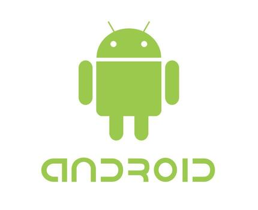
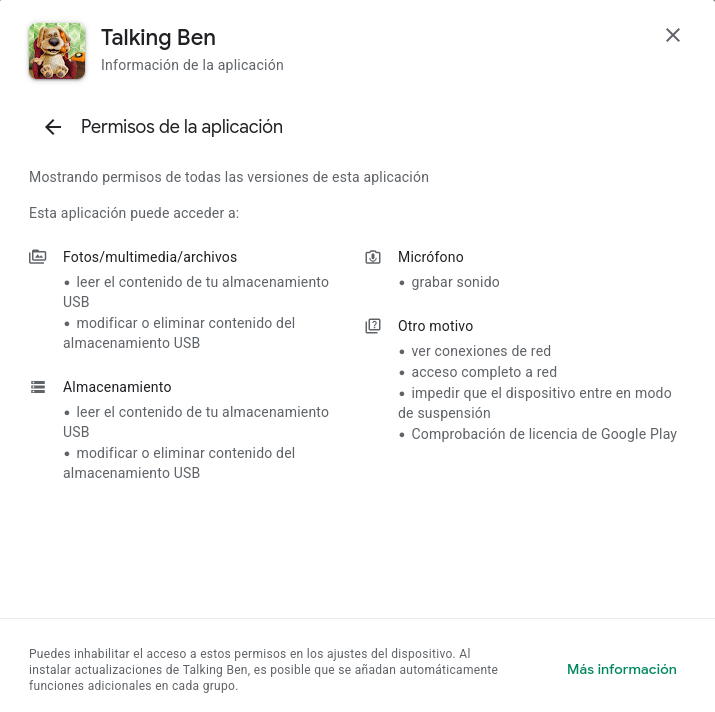

# 🤖 Android

En el apartado Android hay cosas a tener en cuenta, instalaremos soluciones fuera del ecosistema del Google Play que podrian incomodar, pero son probadas y son funcionales. Utilizaremos repositorios verificados y
seguros. Como siempre, no se pretende llegar a extremos al punto de quitarle funcionalidad a nuestro telefono.

  

## ⬇️ Actualizaciones y Soporte

Los celulares android en cuanto a actualizaciones tienen un periodo mas corto de vida del que nos gustaria tener, mas si contamos con un gama baja, un camino alternativo a esto es conseguir una CustomROM, pero no lo llame solucion ya que,
esto requiere desbloquear el BootLoader del telefono, cosa que si usted no cuenta con el conocimiento, no lo recomiendo, existe el riesgo de dejar inutilizable el dispositivo.

# 🌐 Redes Sociales

A menos que usted sea una figura publica, no vale la pena estar exponiendo fotos de lugares a los que concurrimos regularmente, ni hablar si es nuestro hogar en una cuenta ya sea Facebook, Instagram, o cualquier otra red si no la tenemos privada, la mejor alternativa es tener una cuenta para solo familiares y amigos.  

# 🔑 Permisos y Recoleccion de Datos

Al estar por instalar aplicaciones, una buena practica es estar conciente en los detalles de la misma, uno de ellos son los permisos que le concedemos al usarla, podemos pensar que la aplicacion interactua de una manera, pero en realidad lo hace de muchas. Si por ejemplo instalamos un bloc de notas, este no tendria que pedir permisos de microfono, camara o ubicacion, como minimo es sospechoso, ya se sabe que muchas apps hacen este tipo de acciones para monetizar y no solo limitarse a mostrar anuncios, sino vender datos intimos que sin darnos cuenta, les brindamos a estas apps fraudulentas.

  
 
  <em>Este ejemplo es de un juego, porque deberia borrar o ver cosas como fotos?</em>

 

# 📦 Aplicaciones

En Google Play hay una buena cantidad de apps que nos pueden ayudar, como antivirus, limpiadores de archivos, pero las politicas de la tienda suelen limitarlas y no llegan a cumplir completamente sus funcionalidades, por lo que usaremos <a href="https://f-droid.org/" target="_blank">**F-Droid**</a>, 
una tienda con aplicaciones de codigo abierto estrictamente revisadas, donde veremos alternativas mas seguras a lo que podremos encontrar en Google Play.

## 🧰 Aurora Store

Una alternativa privada, ligera y mas segura que Google Play, no necesitamos registro ni una cuenta, funciona como intermediario entre la tienda oficial de la empresa y nosotros. No requiere tanta interaccion con los servicios externos, por lo que funcionara mas rapido. Como advertencia, no descargar aplicaciones de origen dudoso, ya que
como en la de Google, sigue siendo riesgoso. <a href="https://f-droid.org/packages/com.aurora.store/" target="_blank">**Enlace de Descarga**</a>

## 👁️ InviZible Pro

Una de las herramientas mas potentes de toda la lista, no cumple solo una funcion, tiene DNSCrypt, para ocultar consultas DNS que viajan sin cifrar, pudiendo ser interceptadas. Un modulo Tor, para ocultar la identidad, ubicacion, para busquedas delicadas en redes onion, Firewall para controlar el acceso a internet de las aplicaciones que no deseemos y muchas funciones mas. <a href="https://f-droid.org/en/packages/pan.alexander.tordnscrypt.stable/" target="_blank">**Enlace de Descarga**</a> 

## 🛡️ Hypatia

Uno de los antivirus mas completos, escaneo en tiempo real de archivos, no tiene subida de archivos a ningun servidor sin nuestro permiso, bajo uso de bateria, memoria y espacio en almacenamiento. <a href="https://apt.izzysoft.de/fdroid/index/apk/org.maintainteam.hypatia/" target="_blank">**Enlace de Descarga**</a>

