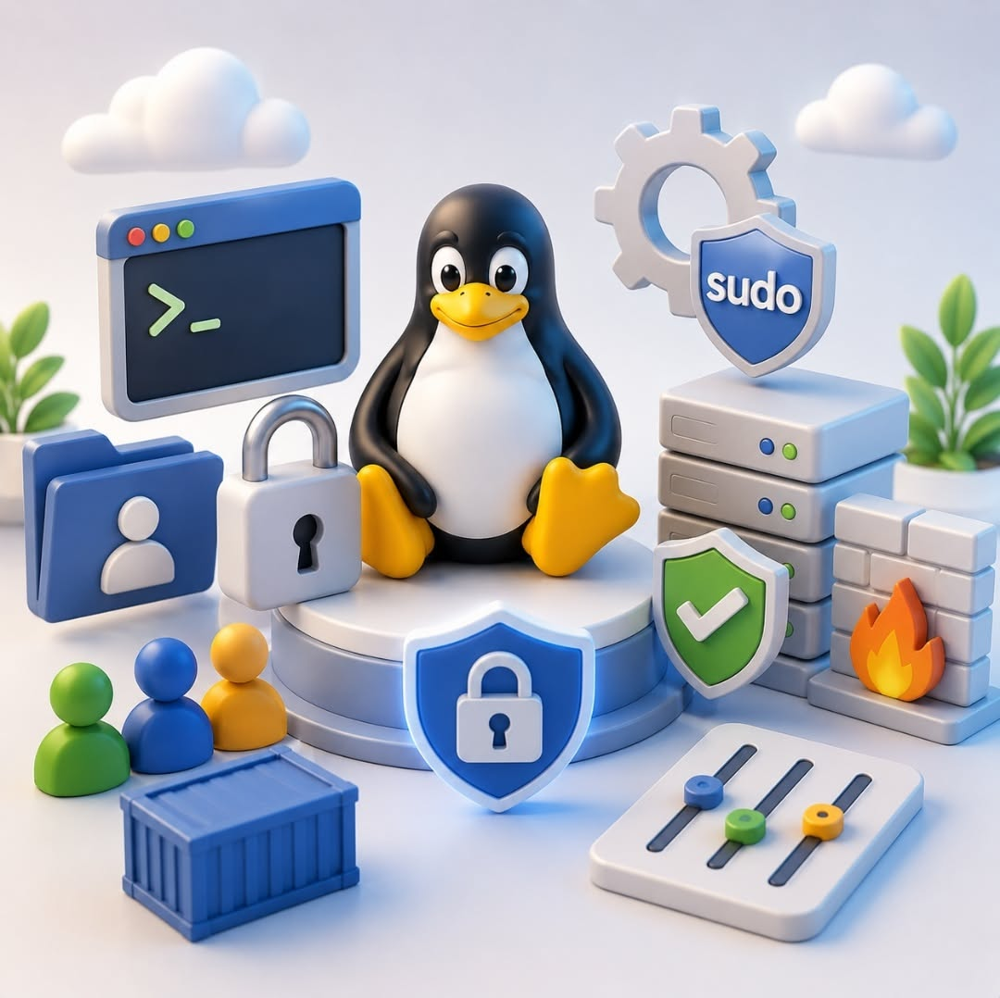

# 🐧 Linux 

En este apartado me enfocare en distribuciones basadas en Ubuntu o Debian, pero muchos o casi todos los paquetes que utilizare tienen sus versiones en sus respectivas distribuciones ya sean basadas en Arch, Fedora, etc.

Ya se conoce la seguridad que brinda Linux al ser flexible y configurable, pero las configuraciones por defecto no son suficientes, debemos hacer una serie de pasos para aprovechar realmente las ventajas que nos brindan las distribuciones de Linux.

<p align="center">
  
</p>

## ⚠️ Atencion

Con esta guia no busco crear una maquina paranoica con configuraciones que puedan comprometer el uso diario, siempre hay que buscar el equilibrio en usabilidad y seguridad sin romper nada. 

## 🛡️ Actualizaciones 

Primero debemos tener actualizado nuestro sistema ya sea en apt o flatpak, con el siguiente comando:

```text
sudo apt update -y && sudo apt upgrade -y && flatpak update -y
```

Para asegurarnos de tener un sistema limpio eliminamos paquetes huerfanos

```text
sudo apt --purge autoremove
```

Si queremos que las actualizaciones de seguridad sean automaticas instalamos este paquete:

```text
sudo apt install unattended-upgrades
```

## 🔥 Firewall

Lo siguiente es configurar un firewall, en este caso utilizaremos UFW, un frontend del firewall del nucleo de linux, nftables o, iptables en sistemas mas antiguos. Traduce cosas como bloquear una ip, que sin UFW, se nos complicaria ya que es tedioso de configurar por si solo, este lo hace de manera sencilla para que el kernel lo entienda.

Lo instalaremos con:

```text
sudo apt install ufw
```

Con UFW podemos bloquear todo el tráfico que intenta entrar a la maquina desde afuera.

```text
sudo ufw default deny incoming
```

Con esta otra regla permitimos conectarnos a internet.

```text
sudo ufw default allow outgoing
```

Si tenemos un puerto ssh configurado debemos permitir la entrada, pero limitarlo para evitar ataques de fuerza bruta.

```text
sudo ufw allow 22/tcp
```
```text
sudo ufw limit ssh
```

Para dejarlo activo para siempre

```text
sudo ufw enable
```

## 🚫 Fail2Ban

En caso de tener un puerto ssh, lo mejor es instalar una herramienta como Fail2Ban que detecta patrones de ataque de fuerza bruta hacia nuestro servidor y bloquea automaticamente ips que intentan entrar.

```text
sudo apt install fail2ban
```

Activamos el servicio de la siguiente manera:

```text
sudo systemctl enable --now fail2ban
```

## 🦠 Antivirus

Un antivirus se dice que no es estrictamente necesario para Linux, pero en caso de necesitarlo la mejor alternativa es ClamAV, utiliza una base de datos con la que al escanear archivos de nuestro sistema y ver que esta fuera de lugar. Nos permite escanear una ruta especifica, eliminar automaticamente archivos infectados, guardar registros y dejar en cuarentena los archivos infectados en una carpeta aislada, en lugar de eliminarlos.

Los comandos mas importantes a continuacion:

```text
sudo apt install clamav clamav-daemon clamav-freshclam
```

Para actualizar la base de datos antes del primer escaneo.

```text
sudo freshclam
```

Para realizar un escaneo a una ruta especifica.

```text
clamscan -r /ruta/al/directorio
```

Podemos activar este servicio para que lo haga de forma automatica.

```text
sudo systemctl start clamav-freshclam
```

En caso de querer una interfaz grafica sencilla, ClamUI. 

```text
flatpak install flathub io.github.linx_systems.ClamUI
```

## SSH

En caso de tener un servidor con entrada ssh deberiamos aplicar las siguientes configuraciones, ya que cualquier acceso no deseado podria exponer a nuestra maquina a un nivel muy peligroso.

El siguiente agregado a la configuracion bloqueara el acceso root para cualquiera que quiera acceder.

```text
sudo nano /etc/ssh/sshd_config.d/99-hardening.conf
```

En este archivo pegamos ```text PermitRootLogin no```

/etc/ssh/sshd_config.d

## 📔 Practicas mas concientes

En este apartado voy a nombrar practicas que deberiamos evitar, en nuestro dia a dia, podemos tener configurado todo lo anterior de este repositorio, pero nosotros mismos podemos ser el peor virus para la pobre maquina.

- Dar permisos elevados como **chmod 777** a scripts que no sabemos que hacen, lo mejor es darselo a la IA y que lo analice antes de hacer nada.
- Utilizar el **sudo** para todas nuestras tareas diarias, solo para actualizaciones o cosas delicadas del estilo, con el usuario root igual.
- Integrar repositorios **PPA** que no conocemos, son repositorios de terceros que pueden ser de un usuario anonimo con malas intenciones, al instalarlos debemos usar permisos de root, lo que podria causar que el atacante tenga acceso completo a nuestro sistema. Siempre usar fuentes confiables y verificadas.  
- Dejar servicios o puertos que no usamos activados, la superficie de ataque de esta manera aumenta. Siempre que desinstalemos o dejemos un paquete revisar si este tenia un servicio corriendo y desactivarlo.

## ⚠️ Sobre AppArmor y SELinux

En sistemas basados en Debian o Ubuntu, AppArmor viene instalado, en distros basadas en Fedora y OpenSUSE, viene SELinux. En la mayoria de veces no es recomendable tocar nada porque estos programas, lo que hacen es configurar la capacidad y permisos de escritura de una aplicacion, por ejemplo, si tengo una aplicacion que cuando se abre genera un archivo en ~/.config y nosostros la restringimos
esta no podra guardar su configuracion y la iniciaremos desde cero. Esto es un ejemplo demasiado sencillo de lo que realmente acciona y realiza cambios un programa como por ejemplo un navegador, que almacena archivos como cookies, sesiones, imagenes, archivos temporales, a parte estos ya traen su sandbox. Su uso deberia ser para un programa muy puntual, al que no le queremos dar tanto acceso a nuestro sistema y ponerle un limite. En la practica
es un metodo muy tecnico que la realidad es mejor documentarse si se quiere integrar a nuestro sistema. Lo que mas recomiendo si se quiere aislar una aplicacion a la que no queremos darle tanto control, es mejor usar alternativas como Flatpak, que tienen su propio mecanismo de proteccion y con Flatseal podemos configurar sus permisos de manera practica y sencilla. 
