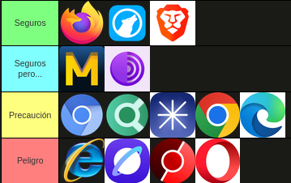

# 🐧 Linux 

Distribuciones basadas en Ubuntu o Debian

Primero debemos tener actualizado nuestro sistema ya sea en apt o flatpak, con el siguiente comando:

```text
sudo apt update -y && sudo apt upgrade -y && flatpak update -y
```

Para asegurarnos de tener un sistema limpio eliminamos paquetes huerfanos

```text
sudo apt --purge autoremove
```

Si queremos que las actualizaciones de seguridad sean automaticas instalamos este paquete:

```text
sudo apt install unattended-upgrades
```

Lo siguiente es configurar un firewall:

```text
sudo apt install ufw
```

Con UFW podemos bloquear todo el tráfico que intenta entrar a la maquina desde afuera.

```text
sudo ufw default deny incoming
```

Con esta otra regla permitimos conectarnos a internet.

```text
sudo ufw default allow outgoing
```
Si tenemos un puerto ssh configurado debemos permitir la entrada, pero limitarlo para evitar ataque de fuerza bruta.

```text
sudo ufw allow 22/tcp
```
```text
sudo ufw limit ssh
```

Para dejarlo activo para siempre

```text
sudo ufw enable
```

# Para todos los dispositivos

No todo es instalar, configurar cosas y dejarlas desantendidas sin importancia. Debemos ser conscientes de nuestros movimientos dentro del sistema, podemos tener el mejor antivirus y el sistema mas seguro del planeta, pero si tenemos malas practicas no servira de nada.

# 🖥️ Navegadores

Para empezar el navegador es uno de los principales vectores de ataque, es muy importante tenerlo actualizado y configurado. Siempre voy a ser partidario del uso de Brave y Firefox, por un lado Brave es un navegador basado en chromium con un monton de protecciones por defecto, como un anti-huella digital para que los sitios no armen un perfil nuestro equipo, un bloqueador de rastreadores y anuncios, con un ritmo rapido de actualizaciones detras de su fork original, Chromium. Firefox tiene la caracteristica de no estar basado en el motor de Google, cosa que los mas entusiastas valoran por encima de Brave, esto se debe a que la empresa Google buena parte de sus ingresos provienen de la publicidad y de los datos de los usuarios.

Una de las mejores herramientas para estar seguros en Firefox que no lleva bloqueador de anuncios como Brave, es usar uBlock Origin, es el mejor bloqueador del planeta, tiene opciones muy variadas de filtros y la posibilidad de agregar listas personalizadas de sitios que queramos bloquear.

A continuacion voy a dejar una captura de tierlist de como califico a los siguientes navegadores para uso diario, OJO con esto no quiero decir que navegador es bueno y cual es malo, solo veo las implicancias que tiene cada uno, como por ejemplo ritmo de actualizaciones, configuraciones por defecto y modelo de negocio.

<p align="center">
  
</p>

- 🟩 Firefox y Brave a mi parecer son los mas seguros y LibreWolf, al ser un Fork de Firefox tiene un pequeño retraso en el ritmo de actualizaciones pero es de 1 a 3 dias, no es fatal para el uso diario, a menos que hablemos de vulnerabilidades de dia 0, pero no ocurre solo con proyectos comunitarios, las Zero-Day afectan a las grandes corporaciones y cada vez con mas frecuencia gracias al avance de la IA.
- 🟦 Mullvad y Tor son los mas grandes proyectos de privacidad si hablamos de navegadores, tienen configuraciones por defecto muy agresivas contra rastreadores, anuncios, incluso contra JavaScript que es el principal culpable del robo de datos. Cada uno tiene su objetivo, para una busqueda normal sin dejar cookies ni sesiones abiertas, Mullvad es el mejor, tiene un boton que borra todo y crea una identidad, Tor es la entrada a las redes onion, donde se alojan sitios web que solo se pueden acceder mediante a este navegador, muy usado para busquedas en paises con mucha censura, aunque es bastante mas lento que los convencionales. El pero que tienen estos dos es por la comodidad, para una persona que le gusta tener todas las sesiones abiertas sin tener que poner credenciales de 0 es inviable y por las restricciones a nivel de configuracion que hacen a estos dos navegadores seguros, pueden romper sitios y hacernos resolver CAPTCHAS uno atras del otro, esto se hace para ver si no somos un bot, recomendados para hacer busquedas delicadas, no para el uso mucho mas frecuente a sitios del dia a dia. 
- 🟨 La precacion por aca va dividida, por un lado por Chrome y Edge, por su modelo de negocio, estos navegadores son recavadores de datos, sin un buen bloqueador de anuncios,  
- 🟥
